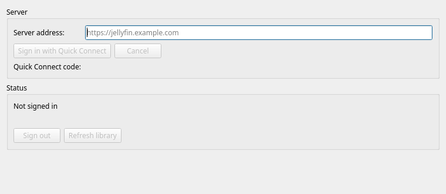

# fooyin-jellyfin

Adds a Jellyfin music library to fooyin, with local metadata, native playlists and on-demand audio streaming. Sign-in uses Quick Connect. The plugin stores session tokens through fooyin's `AccountStore`, the same account database that the scrobbler uses.

Catalog sync runs on connection and when Refresh library is selected. Failed syncs retain the last complete catalog. Love and Unlove update Jellyfin favourites; a failed change restores the previous value and shows a message. Jellyfin playlists are read-only, and playback is reported to the server. The final report sent when fooyin closes is best effort. Signing out hides the catalog while retaining its metadata for reconnection.

The plugin requires [external library support (#4)](https://github.com/nkbt/fooyin/pull/4) from the [`external-libraries` branch of nkbt/fooyin](https://github.com/nkbt/fooyin/tree/external-libraries). It does not work with an unmodified fooyin release.



## Linux build

Requires CMake 3.25 or later, Ninja, a C++23 compiler, Qt 6 and the [fooyin build dependencies](https://github.com/fooyin/fooyin). The credential implementation uses the host account database on every platform. Tests also require GoogleTest, Python 3 and OpenSSL.

From this repository, build the `external-libraries` branch of `nkbt/fooyin`:

```sh
mkdir --parents tmp/runtime
export TMPDIR="$PWD/tmp/runtime"
git clone --branch external-libraries --single-branch https://github.com/nkbt/fooyin.git tmp/fooyin
cmake -S tmp/fooyin -B tmp/fooyin-build -G Ninja -DCMAKE_BUILD_TYPE=Release -DCMAKE_INSTALL_PREFIX="$PWD/tmp/install" -DINSTALL_HEADERS=ON
cmake --build tmp/fooyin-build --parallel 2
cmake --install tmp/fooyin-build
```

Build, test and install the plugin into the same prefix:

```sh
cmake -S . -B tmp/build -G Ninja -DCMAKE_BUILD_TYPE=Release -DCMAKE_PREFIX_PATH="$PWD/tmp/install" -DCMAKE_INSTALL_PREFIX="$PWD/tmp/install" -DFOOYIN_SOURCE_DIR="$PWD/tmp/fooyin" -DBUILD_TESTING=ON
cmake --build tmp/build --parallel 2
FOOYIN_PLUGIN_PATH="$PWD/tmp/install/lib/fooyin/plugins" QT_QPA_PLATFORM=offscreen ctest --test-dir tmp/build --output-on-failure --parallel 2
cmake --install tmp/build
```

Tests use synthetic accounts, temporary account databases, media and local servers. No running Jellyfin server is needed for the test suite. Set `FOOYIN_SOURCE_DIR` to the matching fooyin source to include native library and playback integration tests.

## macOS

Install Xcode and its command-line tools. Install the build dependencies with Homebrew:

```sh
HOMEBREW_NO_AUTO_UPDATE=1 HOMEBREW_NO_INSTALL_CLEANUP=1 brew install cmake ninja pkgconf qtbase qtsvg qttools taglib ffmpeg icu4c@78 libarchive sdl2 googletest
```

Use the `external-libraries` host branch and the standalone scrobbler. Build all three projects against the same Qt installation and fooyin SDK. From this repository, configure the host:

```sh
git clone --branch external-libraries --single-branch https://github.com/nkbt/fooyin.git tmp/fooyin
export FOOYIN_PREFIX="$PWD/tmp/macos-sdk"
export FOOYIN_INSTALL_PREFIX="$PWD/tmp/macos-install"
cmake -S tmp/fooyin -B tmp/macos-host -G Ninja -DCMAKE_BUILD_TYPE=Release -DCMAKE_PREFIX_PATH="$(brew --prefix);$(brew --prefix icu4c@78)" -DCMAKE_INSTALL_PREFIX="$FOOYIN_INSTALL_PREFIX" -DINSTALL_HEADERS=ON -DBUILD_TESTING=ON -DPLUGIN_SELECTION=-scrobbler
QT_QPA_PLATFORM=offscreen cmake --build tmp/macos-host --parallel 2
cmake --install tmp/macos-host --component fooyin_development --prefix "$FOOYIN_PREFIX"
```

Finish each installation command before starting another command that changes the same prefix. Qt test discovery requires `QT_QPA_PLATFORM=offscreen` on macOS. The host keeps its test executables outside the app bundle. Keep the development SDK separate from the deployed app so tests load one copy of Qt.

Homebrew's SDL2 package uses SDL2-compat, which loads SDL3 dynamically. The host installation copies the real SDL3 library into `Contents/Frameworks/libSDL3.dylib`. A Homebrew symlink cannot replace this bundled file. Complete dependency deployment before signing the app. Deployment can take several minutes.

Build and install Jellyfin into the same prefix:

```sh
cmake -S . -B tmp/macos-build -G Ninja -DCMAKE_BUILD_TYPE=Release -DCMAKE_PREFIX_PATH="$FOOYIN_PREFIX;$(brew --prefix)" -DCMAKE_INSTALL_PREFIX="$FOOYIN_INSTALL_PREFIX" -DFOOYIN_SOURCE_DIR="$PWD/tmp/fooyin" -DBUILD_TESTING=ON -DOPENSSL_EXECUTABLE="$(brew --prefix openssl@3)/bin/openssl"
QT_QPA_PLATFORM=offscreen cmake --build tmp/macos-build --parallel 2
FOOYIN_PLUGIN_PATH="$PWD/tmp/macos-host/run/fooyin.app/Contents/PlugIns" QT_QPA_PLATFORM=offscreen ctest --test-dir tmp/macos-build --output-on-failure --parallel 2
cmake --install tmp/macos-build
```

Install the [standalone scrobbler](https://github.com/nkbt/fooyin-scrobbler#macos) into this prefix before the final bundle deployment. The plugin files use the `.so` suffix on macOS and belong in `fooyin.app/Contents/PlugIns`.

Deploy the dependencies after both plugins are present, then sign the complete bundle locally:

```sh
cmake --install tmp/macos-host --component fooyin
codesign --force --deep --sign - "$FOOYIN_INSTALL_PREFIX/fooyin.app"
codesign --verify --deep --strict "$FOOYIN_INSTALL_PREFIX/fooyin.app"
```

The local signature supports a source installation on this Mac. It does not provide Apple notarisation. Sign again after changing a plugin or a bundled library.

Copy the app into the user Applications directory and start it:

```sh
mkdir -p "$HOME/Applications"
ditto "$FOOYIN_INSTALL_PREFIX/fooyin.app" "$HOME/Applications/fooyin.app"
open "$HOME/Applications/fooyin.app"
```

Jellyfin credentials reside in `fooyin.db` under `Accounts/Jellyfin/<credential-record-id>`. `AccountStore` stores these values without encryption, as it does for scrobbler accounts. Keep profile directories and backups private.

## Move a profile to macOS

Close fooyin on the destination before copying a profile. Back up the destination directories before replacing them. Use a SQLite backup when the source player is running.

| Linux directory | macOS directory |
| --- | --- |
| `~/.config/fooyin` | `~/Library/Preferences/fooyin` |
| `~/.local/share/fooyin` | `~/Library/Application Support/fooyin` |
| `~/.local/state/fooyin` | `~/Library/Application Support/fooyin` |
| `~/.cache/fooyin` | `~/Library/Caches/fooyin` |

Keep `fooyin.conf`, `fooyin.state`, the layouts and `fooyin.db` together. Merge the state directory into the macOS data directory. Copy the cache to retain artwork and waveform data. Select `SDL2 (coreaudio)` and the default device for audio output. Start the destination paused when the source player is active.

The account database contains the current scrobbler credentials. The accepted Jellyfin connection also uses `jellyfin/credential-state.json` in the configuration directory. A connection whose token is absent from `AccountStore` requires an import or a new Quick Connect sign-in. An imported token must match the connection's credential record. Its account value uses the `AccessToken` field.

## Connect

Start the local Linux build with an isolated profile:

```sh
scripts/launch-candidate.sh --host-prefix "$PWD/tmp/install" --profile-dir "$PWD/tmp/profile"
```

Open Settings → Integrations → Jellyfin, enter the server address and select Sign in with Quick Connect. Authorise the displayed code in a signed-in Jellyfin client. Quick Connect must be enabled on the server, and fooyin must have write access to its account database.

The host PR adds external library snapshots, source-owned playlists and playback lifecycle events. Plugin code remains separate under `src/`.

## Scrobbling

Scrobbling is optional. To submit Now Playing and completed scrobbles for Jellyfin playback, use the standalone scrobbler module from the `master` branch of [nkbt/fooyin-scrobbler](https://github.com/nkbt/fooyin-scrobbler) instead of the bundled scrobbler.

The standalone module keeps the scrobbler plugin identity and settings names, so existing scrobbler services and settings stay in use. Do not load it together with the bundled scrobbler. Add `-DPLUGIN_SELECTION=-scrobbler` to the fooyin configure command above, then build, test and install the module into the same prefix:

```sh
git clone --branch master --single-branch https://github.com/nkbt/fooyin-scrobbler.git tmp/fooyin-scrobbler
cmake -S tmp/fooyin-scrobbler -B tmp/scrobbler-build -G Ninja -DCMAKE_BUILD_TYPE=Release -DBUILD_TESTING=ON -DFooyin_DIR="$PWD/tmp/install/lib/cmake/fooyin" -DCMAKE_PREFIX_PATH="$PWD/tmp/install" -DCMAKE_INSTALL_PREFIX="$PWD/tmp/install"
cmake --build tmp/scrobbler-build --parallel 2
ctest --test-dir tmp/scrobbler-build --output-on-failure --parallel 1
cmake --install tmp/scrobbler-build
```

Start the isolated profile and enable scrobbling on the General page in Settings → Integrations → Scrobbling. Configure and enable a service on the Services page, apply the settings and play an eligible Jellyfin track. The service shows the track as Now Playing and records a scrobble after the configured listening threshold.

Released under GPL-3.0-or-later. See [COPYING](COPYING).
